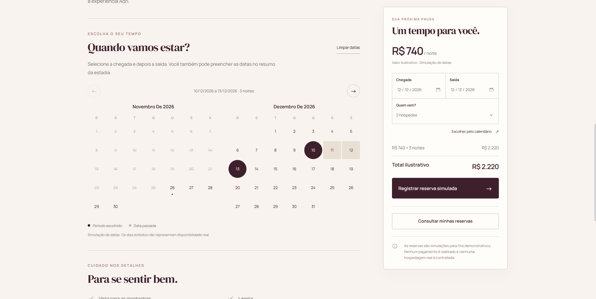
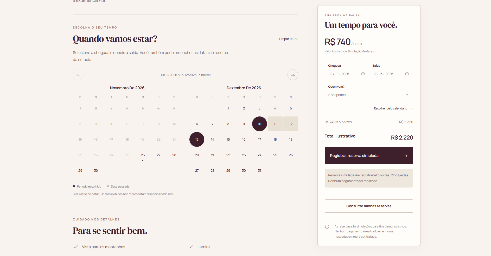
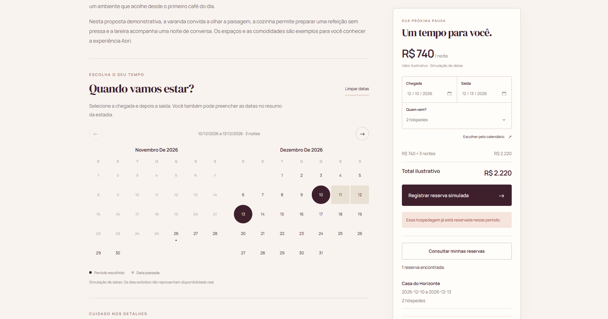

# 🌿 Aori — Sistema de Reserva de Hotéis

**Uma nova forma de descobrir, explorar e reservar hospedagens.**

O **Aori** é um sistema web de reservas de hotéis desenvolvido como projeto acadêmico. A proposta é criar uma plataforma moderna, intuitiva e visualmente agradável, que simplifique a busca por hospedagens e ofereça uma experiência personalizada aos usuários.

O projeto combina conceitos de **desenvolvimento web, banco de dados, experiência do usuário (UX) e design de interfaces (UI)**.

---

## 📌 Sobre o projeto

O Aori foi idealizado para proporcionar uma experiência de navegação simples e organizada, permitindo que os usuários descubram hotéis, consultem quartos disponíveis e simulem reservas.

Seu diferencial é o **Aori Mood**, uma funcionalidade de descoberta de hospedagens baseada no estilo de viagem e nas preferências do usuário.

A identidade visual segue uma proposta minimalista e editorial, com cores suaves, elementos naturais e foco na usabilidade.

> **Importante:** O Aori é um projeto exclusivamente acadêmico. As reservas e os pagamentos são simulados, sem movimentação financeira real.

## ✨ Funcionalidades

### 🏨 Exploração de hospedagens
- Visualização de hotéis e acomodações.
- Pesquisa e filtros de hospedagens.
- Consulta de informações, características e valores.
- Visualização dos detalhes dos quartos.

### 🍃 Aori Mood
- Descoberta de hospedagens por estilo de experiência.
- Navegação personalizada conforme preferências.
- Sugestões de acomodações relacionadas ao perfil escolhido.

### 📅 Reservas
- Seleção de quartos e períodos de hospedagem.
- Simulação de reserva e cálculo do valor total.
- Confirmação simulada de reservas.
- Consulta e acompanhamento das reservas.

### 👤 Área do usuário
- Cadastro e autenticação.
- Gerenciamento de informações pessoais.
- Histórico de reservas.
- Acesso à área da conta.

### ⚙️ Gestão hoteleira
- Cadastro e gerenciamento de quartos.
- Controle de clientes.
- Gerenciamento de reservas.
- Registro de pagamentos simulados.
- Cadastro e controle de funcionários.

---

## 🗺️ Estrutura de navegação

A navegação principal do Aori está organizada em quatro áreas:

| Área | Descrição |
|---|---|
| Explorar | Descoberta e pesquisa de hotéis |
| Coleções | Hospedagens organizadas por estilos e experiências |
| Reservas | Consulta e gerenciamento das reservas |
| Conta | Cadastro, login e informações do usuário |

O sistema contempla **13 telas principais**, com fluxos de navegação planejados para proporcionar uma experiência consistente.

Para prosseguir à etapa de finalização de uma reserva, o usuário deverá estar autenticado.

## 🗄️ Estrutura do banco de dados

O banco de dados relacional foi planejado com cinco entidades principais, conforme os requisitos acadêmicos.

### Quartos
`ID`, `Número`, `Tipo`, `Status`, `Valor_Diária`

### Reservas
`ID`, `ID_Quarto`, `ID_Cliente`, `Data_CheckIn`, `Data_CheckOut`, `Valor_Total`

### Clientes
`ID`, `Nome`, `CPF`, `Telefone`, `Email`

### Pagamentos
`ID`, `ID_Reserva`, `Valor`, `Data_Pagamento`, `Método`

### Funcionários
`ID`, `Nome`, `Cargo`, `Login`, `Senha`

**Relacionamentos principais:**
- Um cliente pode possuir várias reservas.
- Um quarto pode estar associado a diferentes reservas ao longo do tempo.
- Cada reserva está vinculada a um cliente e a um quarto.
- Os pagamentos estão vinculados às respectivas reservas.

As senhas dos funcionários deverão ser armazenadas de forma segura, utilizando hash, nunca em texto puro.

---

## 🎨 Identidade visual

O Aori utiliza uma identidade visual inspirada na tranquilidade, no conforto e na conexão com experiências de viagem.

**Diretrizes de design:**
- Estilo minimalista e editorial.
- Paleta de cores suaves, com tons naturais.
- Tipografia elegante e legível.
- Layouts organizados e responsivos.
- Elementos visuais discretos.
- Navegação intuitiva.

A identidade visual e a logomarca original do Aori foram previamente definidas para manter consistência em todas as telas.

## 🎓 Objetivos acadêmicos

O desenvolvimento do Aori tem como objetivos:

1. Aplicar conceitos de modelagem de banco de dados relacional.
2. Implementar operações de cadastro, consulta, atualização e exclusão de registros.
3. Desenvolver uma interface web funcional e responsiva.
4. Trabalhar relacionamentos entre clientes, quartos, reservas e pagamentos.
5. Aplicar boas práticas de organização de código e desenvolvimento de sistemas.
6. Integrar conhecimentos de UX/UI ao desenvolvimento de software.

## 🔒 Limitações do projeto

Por se tratar de um protótipo acadêmico:

- Não serão processados pagamentos reais.
- Não haverá integração obrigatória com gateways de pagamento.
- As reservas não serão enviadas a hotéis reais.
- As informações de hospedagens poderão ser demonstrativas.
- O sistema será utilizado exclusivamente para fins educacionais.

## 📁 Organização do projeto

Os arquivos de identidade visual, incluindo logotipo, imagens, ícones e elementos gráficos, estão organizados no diretório local:

`C:\a3`

Esses recursos devem ser reutilizados durante o desenvolvimento, preservando a identidade visual aprovada.

## 🚀 Status do projeto

**Em desenvolvimento acadêmico.**

O projeto contempla as etapas de planejamento, modelagem de banco de dados, definição de funcionalidades, prototipação de interfaces, implementação e testes.

---

**Aori — Sua próxima experiência começa aqui.** 🌿

*Projeto desenvolvido para fins acadêmicos.*

## Implementação disponível

A versão atual do Aori inclui um catálogo demonstrativo com seis hospedagens em Santa Catarina, filtros de busca, página de detalhes das estadias, cadastro e login de clientes e favoritos persistidos em SQLite.

Também foi implementado o **sistema de reservas simuladas**, permitindo:

- Registrar reservas para clientes autenticados.
- Validar datas de entrada e saída e quantidade de hóspedes.
- Impedir reservas conflitantes para a mesma hospedagem.
- Consultar as reservas vinculadas à conta do cliente.
- Persistir os registros no banco SQLite, sem movimentação financeira.

### Como executar

Requer Node.js 24 ou superior.

```bash
npm ci
npm start
```

Acesse http://localhost:4173/.

### Testes e qualidade

Para executar os testes automatizados:

```bash
npm test
```

Para verificar a sintaxe:

```bash
npm run check
```

**Resultados da verificação:**

- 35 testes automatizados aprovados.
- 91,95% de cobertura de linhas, superando a meta mínima de 75%.
- Integração contínua configurada com GitHub Actions.
- Análise estática com SonarQube Cloud e Quality Gate aprovado na branch `/main`.

O banco preserva as tabelas originais `Clientes`, `Pagamentos` e `Funcionários`, acrescentando as estruturas necessárias para autenticação, hospedagens, favoritos e reservas simuladas.

Consulte a [documentação da implementação](docs/implementacao-local.md) e a [estrutura do banco e API](database/README.md).

**Referências:** [Issue #1](https://github.com/DudaAlvess/Aori/issues/1) · [Pull Request #2](https://github.com/DudaAlvess/Aori/pull/2).


## 📸 Demonstração das reservas simuladas

A funcionalidade de reservas do Aori permite que clientes autenticados registrem e consultem reservas, com validação de datas e bloqueio de períodos conflitantes.

### 1. Preenchimento da reserva

O cliente seleciona a hospedagem, informa as datas e a quantidade de hóspedes.



### 2. Confirmação da reserva

O sistema registra a reserva simulada no banco de dados SQLite e apresenta uma mensagem de sucesso.



### 3. Consulta das reservas

O cliente autenticado pode consultar as reservas registradas em sua conta.


### 4. Bloqueio de reservas conflitantes

O sistema impede uma segunda reserva para a mesma hospedagem quando os períodos se sobrepõem.



### Resultados dos testes e análise de qualidade

- 35 testes automatizados aprovados.
- Cobertura geral de linhas (c8): 91,95%.
- Cobertura geral (SonarCloud): 87,7%.
- Cobertura do código novo (SonarCloud): 81,63%.
- Quality Gate: **PASSED**.
